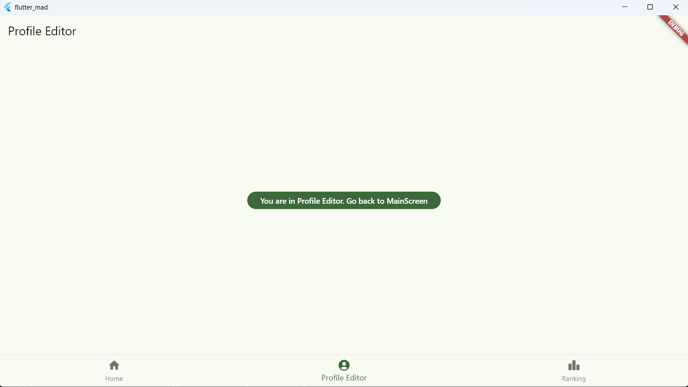

# BioBond (with Flutter/Dart)

## Members
- Sergio Pastor Mesas (bt0385) ([GitHub](https://github.com/bt0385))
- Gabriel Gutiérrez Fuentes (bt0055) ([GitHub](https://github.com/gabgutf))

## Links
GitHub:
- Repository: https://github.com/bt0385/FlutterProjectMAD
- Releases: https://github.com/bt0385/FlutterProjectMAD/releases

Sharepoint:
- Landing page: https://upm365.sharepoint.com/sites/MAD26GS/SitePages/Home.aspx
- Tracking: https://upm365.sharepoint.com/sites/MAD26GS/SitePages/Tracking.aspx

## Description
BioBond is an app that seeks to teach users (in a non-boring way) what the flora needs to live and the importance of keeping their habitats safe from harm. Customize your profile, complete missions, get points and compete in the leaderboard!!

## Screenshots of the App

|*Main Screen*|  |*Profile Editor Screen*|  |*Ranking Screen*| 
