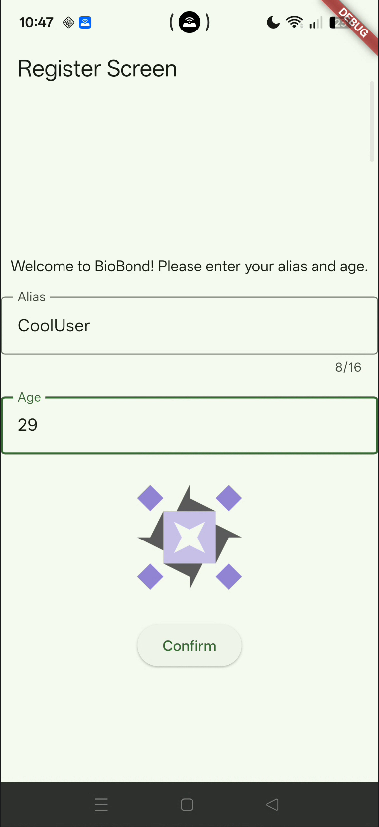
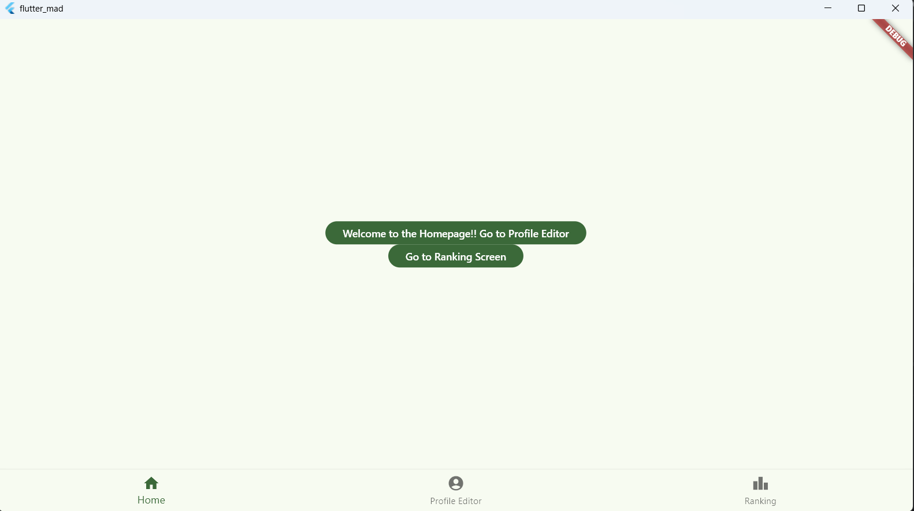
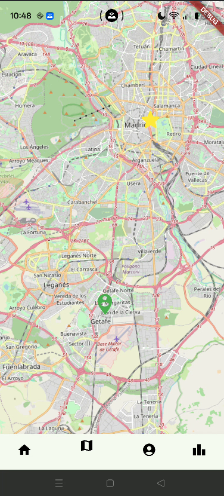
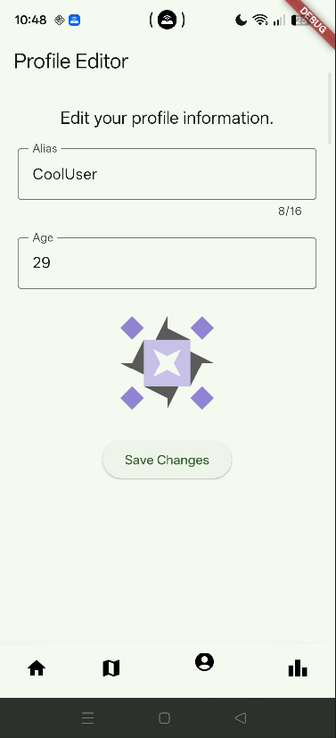
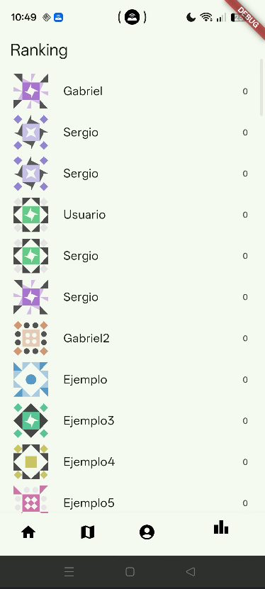

# BioBond (with Flutter/Dart)

## Members
- Sergio Pastor Mesas (bt0385) ([GitHub](https://github.com/bt0385)) (sergio.pastor@alumnos.upm.es)
- Gabriel Gutiérrez Fuentes (bt0055) ([GitHub](https://github.com/gabgutf)) (gabriel.gutierrez@alumnos.upm.es)

## Links
GitHub:
- Repository: https://github.com/bt0385/FlutterProjectMAD
- Releases: https://github.com/bt0385/FlutterProjectMAD/releases

Sharepoint:
- Landing page: https://upm365.sharepoint.com/sites/MAD26GS/SitePages/Home.aspx
- Tracking: https://upm365.sharepoint.com/sites/MAD26GS/SitePages/Tracking.aspx

## Description
BioBond is an app that seeks to teach users (in a non-boring way) what the flora needs to live and the importance of keeping their habitats safe from harm. Customize your profile, complete missions, get points and compete in the leaderboard!!

## Screenshots of the App
|*Login Screen*|  |*Register Screen*|  |*Main Screen*|  |*OpenStreetMaps Screen*|  |*Profile Editor Screen*|  |*Ranking Screen*| 

## Demo Video
<INSERT VIDEO HERE>

## Features
- ## FUNCTIONAL
  - Profile creation and edition with high customizations.
  - Plant-selecting system to make the user choose a new plant every 2 weeks.
  - Mission system based on plant's main necessity (Higher probability to get missions of your plant's necessity).
  - Capability to see current mission locations and user's position in a map.
  - Ranking system based on points achived through the missions.
- ## TECHNICAL
  - Includes Authentication via email and password and data storage implementation with Firebase.
  - Connected to a common API created by us where all user data is stored.
  - Bottom navigation menu for a better and comfortable user experience.
  - Usage of plant images in dialogues and MainScreen using Image.network.
  - Usage of GPS sensors for mission system.
 
## How to Use
When opening the app, you will firstly have to log in using a valid account added in Firebase in case of new users or after loggin out.
New users will be able asked to choose a plant between 3 randomly taken.
Each plant has a main necessity (Sun, Water, Friends or Other). Once agreed to the GPS permission, the user will get a mission based on the current plant's necessity.
The user can see his/her location using the map, and once being in a radius of 50 meters or less, the mission will be completed and 100 points will be given.
You can see your current ponts in the leaderboard and modify any parameters of your profile in the profile editor.
Every 2 weeks a new plant will be chosen to replace the old one.

## IMPORTANT
The only requirement to use the app is to log in with a valid account in Firebase. Regardless of the account the user logs in, the progress in the device will be the same between them.
Go to the app's information in your device and delete the data in order to start as a new player.
